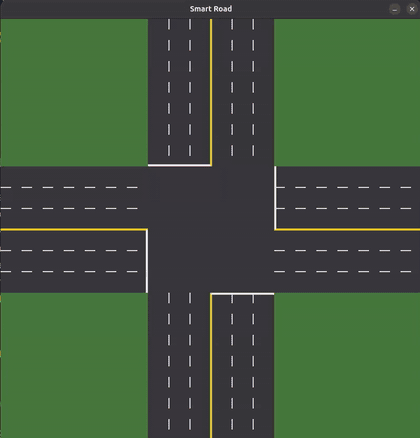

# Smart Road

A Rust + SDL2 simulation of self-driving cars crossing a four-way intersection **without traffic lights**. Instead of signals, a smart intersection manager reserves space inside the junction for each car, so vehicles pass without collisions and with as little waiting as possible.

## Demo



[Full-quality video (MP4)](demo.mp4)

## How it works

- **Fixed routes per lane.** Every incoming road has three lanes: turn right, go straight, turn left. A car never changes lane or route, so its whole path is known the moment it spawns.
- **Reservation-based intersection.** The intersection box is split into a 6×6 grid. Each of the 12 possible paths has a precomputed footprint of grid cells. When a car approaches, it is granted the cells it needs only if no car from a conflicting lane holds them; cells are released as soon as the car leaves them, so the next car can go sooner. Cars without a reservation slow down and stop at the line.
- **Car-following with safe distance.** Each car checks the gap to the car ahead in its lane and picks one of three speeds (slow, medium, fast) or stops, never closing below a fixed safety gap.
- **Animated turns.** Turns follow quarter-circle arcs and the sprite rotates along the path.

## Controls

| Key | Action |
| --- | --- |
| `↑` | Spawn a car from the south, heading north |
| `↓` | Spawn a car from the north, heading south |
| `→` | Spawn a car from the west, heading east |
| `←` | Spawn a car from the east, heading west |
| `R` | Toggle continuous random spawning |
| `Esc` | End the simulation and show statistics |

Spamming a key won't stack cars on top of each other — a new car only spawns once the lane has room.

## Statistics

When the simulation ends, a window shows:

- Vehicles that passed the intersection
- Max / min velocity
- Max / min time to cross the intersection
- Close calls (safe-distance violations)

## Running

Requires Rust (2024 edition) and the SDL2, SDL2_ttf and SDL2_image development libraries.

```bash
# Debian/Ubuntu
sudo apt install libsdl2-dev libsdl2-ttf-dev libsdl2-image-dev

cargo run --release
```

Run the tests with `cargo test`.

## Project layout

| File | Purpose |
| --- | --- |
| [`src/main.rs`](src/main.rs) | Window, game loop, input, rendering |
| [`src/world.rs`](src/world.rs) | World dimensions and road drawing |
| [`src/vehicle.rs`](src/vehicle.rs) | Vehicle model, speeds, car-following, spawn guard |
| [`src/route.rs`](src/route.rs) | Path geometry for all 12 lane routes |
| [`src/intersection.rs`](src/intersection.rs) | Grid reservation system |
| [`src/stats.rs`](src/stats.rs) | Statistics collection and results window |

See [FILES_EXPLAINED.md](FILES_EXPLAINED.md) for a function-by-function walkthrough and [README(7).md](README(7).md) for the original project brief.
